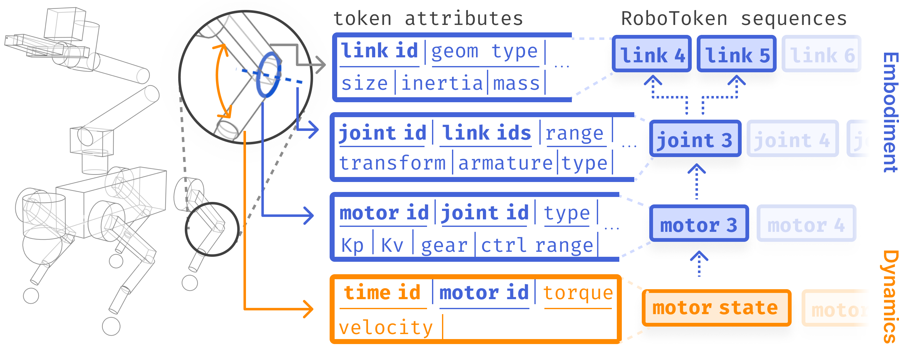

# Concrete visual production recipes

These recipes are our operational recommendations. Their lecture basis is indexed in [lecture principles](lecture-principles.md): [visual purposes, pp. 75–77](https://huy-ha.github.io/assets/presenting_your_research.pdf#page=75), [shots, pp. 80–90](https://huy-ha.github.io/assets/presenting_your_research.pdf#page=80), [lights, pp. 91–92](https://huy-ha.github.io/assets/presenting_your_research.pdf#page=91), and [importers, pp. 99–101](https://huy-ha.github.io/assets/presenting_your_research.pdf#page=99). Choose a recipe because it answers a communication problem, not because it adds production complexity.

## Recipe 1: explain a manipulation through three camera jobs

**Hypothetical production plan:** a robot hand transfers an object between contacts. No successful behavior or experiment outcome is assumed.

| View | Composition | Communication job | Export use |
|---|---|---|---|
| Complete evidence view | Fixed camera contains the hand, object, relevant support, and entire motion envelope. Start before interaction and finish after the outcome. | Let a reader inspect what happened without hidden action. | A continuous scientific recording with speed and provenance identified. |
| Mechanism view | Medium close-up at hand/object height; both contact surfaces remain visible. | Explain the contact change or object motion named in the caption. | A page explanation paired with the complete source recording. |
| Entry shot | A wider composition or restrained camera move introduces the physical setup and then the salient behavior. | Establish task and visual interest. | Clearly identified promotional footage. |

First replay the trajectory from the fixed view. Check the beginning, largest excursion, critical contact, and final state before choosing a crop. A close-up that excludes the landing or receiving contact cannot establish a transfer outcome. For a moving promotional camera, choose an existing trajectory recording and preserve its motion; camera movement must not create a false impression of object motion.

Make separate captions for separate jobs. An evidence caption describes task, condition, speed, and visible outcome. A mechanism caption tells the reader where to look and which relationship is being illustrated. A promotional caption can introduce the capability, but should point to the evidence that supports any performance claim. Edited cuts and selected successes remain selected footage.

## Recipe 2: make contact geometry readable before adding effects

Start with one soft key light offset from the camera so curved hand links and the object have readable shape. Inspect a frame at the critical contact. If silhouettes merge with the background, add a restrained rim light. If shadows hide the interacting surfaces, adjust a weaker fill light. Keep highlights from saturating the contact area.

For a simulated object, use its existing geometry and materials. Change the background or lighting before replacing the object with a more attractive asset: the substitution may change the scientific meaning. For transparent or reflective objects, inspect the whole motion as well as a still frame; a beautiful initial frame can become unreadable when the object rotates.

A useful visual comparison is two renders of the **same** frame and trajectory with different lighting. Choose the one that makes the relevant spatial relationship easiest to inspect. This is a production comparison, not an algorithmic ablation.

## Recipe 3: give a figure three reading tiers

The [representation section of the reference case](https://transformer-transformer.github.io/#robotokens) is the study location. Open the source figure while reading this recipe:

Produce your own editable figure with three independent jobs:

1. **Figure:** show entities and relationships at a glance. The overall flow and semantic color groups should remain recognizable when the figure is reduced to the intended page width.
2. **Caption:** explain how to read the figure and what it establishes. Name the input/output relationship and decode colors, arrows, or overlays.
3. **Body:** explain the mechanism and its necessary qualification. Put formal definitions and technical rationale here rather than compressing them into the image.

**Hypothetical hand-transfer figure layout.** Place the source demonstration on the left, an interaction representation in the middle, and the target hand on the right. Keep the object at consistent visual scale. Use labeled arrows to distinguish “extract interaction” from “produce robot motion”; those are planned labels and must match the actual method. Below, place a real comparison only when supplied by the author. Do not draw a synthetic failure and label it as a baseline result.

**Caption adaptation:** “Read left to right: the demonstration supplies the source motion, the middle panel shows the interaction information, and the right panel shows the corresponding robot motion. The overlay identifies [the actual quantity].” Replace the bracket with the real quantity before delivery. This explains reading order; a separate sentence should state a verified finding if the figure establishes one.

**Body adaptation:** answer why that intermediate information is necessary and how the implementation obtains it. A diagram of a proposed pipeline establishes organization; it does not establish superiority over another method. Use the evaluation visual for that claim.

## Recipe 4: reuse a simulation-to-render path

Before writing an importer, inspect the project's current viewer and exporter. The source [visualization Q&A](https://umi-on-legs.github.io/#visualization-qa) links existing routes; consult the linked code and its environment requirements rather than treating one simulator's workflow as universal.

Preserve a small explicit data contract: robot/object asset identifiers, world transforms, joint states, timestamps, and the quantities to visualize. Import geometry once, apply recorded motion, then author materials, cameras, and lights in the renderer. Use the existing simulator for physics. Rendering should replay the source behavior, not silently recompute a different experiment.

Verify one representative frame and one short motion interval against the existing viewer before rendering the full sequence. Check pose, scale, orientation, contact timing, and playback duration. Retain the editable scene or viewer configuration alongside the export so a camera or label correction does not require reconstructing the experiment.

## Review the actual output honestly

Record what was inspected, at what size, and with which source. A useful review note is specific: “Opened the narrow page preview; the legend is readable, but the object leaves the close-up during the transfer.” It is more informative than “visual QA passed.”

- **Meaning:** Can the reader name the visible behavior and the condition being compared?
- **Evidence:** Does the framing preserve the events needed for the claim? Are edited material, playback speed, simulation, and physical recordings identified where relevant?
- **Hierarchy:** Does the main relationship remain readable at the delivered size? Does the caption explain rather than repeat?
- **Timing:** Does the reveal coincide with the spoken concept? Can a webpage reader pause and inspect the important state?
- **Integrity:** Does the render match the source trajectory? Are reference assets attributed and kept distinct from the project's own results?
- **Delivery:** Do exported images load and clips play? Are editable sources and scientific recordings accessible from the delivered artifact?

Fix the observed problem and repeat the affected check. Do not claim that an export, a source file, or an attractive still frame proves that the complete page or video was reviewed.
