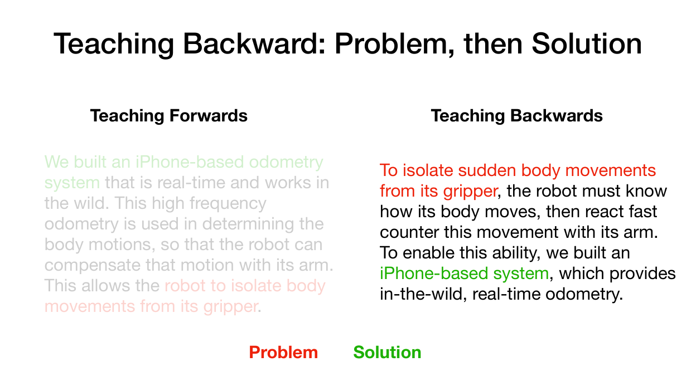
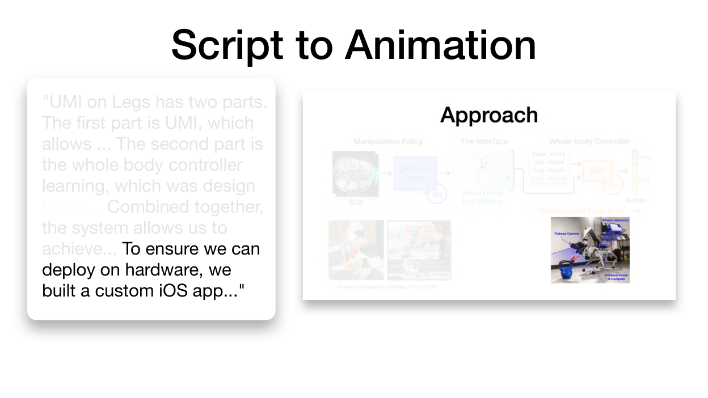
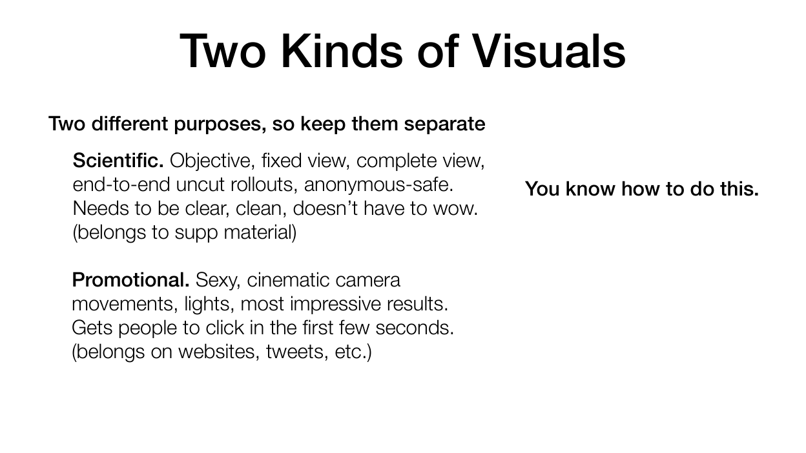

# 把讲座原则变成可执行的做法

用这份参考文档修正难以理解的解释。引文采用 Huy Ha 的 103 页[讲座](https://huy-ha.github.io/assets/presenting_your_research.pdf)中**从 1 开始计数的 PDF 页码**。编号原则概括讲座明确提出的建议；练习与具体措辞是我们的改编。

## 来源事实：讲座实际教了什么

1. **读者：** 考虑读者已有的知识、兴趣，以及愿意投入多少精力来理解内容（[第 25–28 页](https://huy-ha.github.io/assets/presenting_your_research.pdf#page=25)）。
2. **信息级联（information cascade）：** 社交媒体帖子、视频、网站、演讲、论文和代码分别服务于投入程度逐步增加的读者；网站既需要简短结论，也需要更深入的回答（[第 32–40 页](https://huy-ha.github.io/assets/presenting_your_research.pdf#page=32)）。
3. **逆向教学（backward teaching）：** 先给具体例子与反例，再给定义；先建立问题或展示结果，再讲解决方案（[第 44–50 页](https://huy-ha.github.io/assets/presenting_your_research.pdf#page=44)）。
4. **标题与注意力：** 信息明确的标题帮助读者重新进入内容；简单的逐步呈现应与口述关键词同步（[第 51–54 页](https://huy-ha.github.io/assets/presenting_your_research.pdf#page=51)、[第 63–72 页](https://huy-ha.github.io/assets/presenting_your_research.pdf#page=63)）。
5. **视觉用途：** 科学视频保留客观、完整、连续的观察；宣传视频则可以采用电影式的片段选择（[第 75–77 页](https://huy-ha.github.io/assets/presenting_your_research.pdf#page=75)）。
6. **制作：** 变化景别与相机运动；使用柔和照明、轮廓光和补光；借助已有工具把仿真导入 Blender（[第 80–92 页](https://huy-ha.github.io/assets/presenting_your_research.pdf#page=80)、[第 99–101 页](https://huy-ha.github.io/assets/presenting_your_research.pdf#page=99)）。

## 读者约定示例：灵巧手项目页

**这是一个假设练习，不是实验报告。** 假设一位研究者想制作一个项目页，介绍如何把人类操作演示迁移到机器人手上。项目应当有自己的实际结果；本练习不编造成功率、比较结果或经过验证的机制。

润色引言前，先写出三项决策：

| 维度 | 需要检验的具体假设 | 对页面的影响 |
|---|---|---|
| 知识 | 机器人领域的访客理解演示和策略，但可能不了解项目的接触表示。 | 引入表示符号前，先展示被操作物体和手的运动。 |
| 兴趣 | 访客想知道，面对不同的手，哪些内容仍能迁移。 | 在第一个能力展示旁边呈现人类与机器人的对应关系。 |
| 投入 | 普通访客可能只浏览；潜在合作者则可能检查机制。 | 让简短说明独立成立，再链接到表示与评估的细节。 |

这是一份拟定的读者约定，不是适用于所有人的群体画像。面向专家的报告或大众演示应调整这些假设。

**虚构的模块优先草稿：** “我们的管线包括重建、重定向和跟踪策略。”

**从问题出发的改编：** “人类与机器人的手在几何结构上不同。因此，演示需要转化为机器人能够执行的运动，同时保留操作意图。”

第二个版本让模块有了具体职责。接下来展示作者提供的真实示例。一个有用的反例可以是真实录制的情形：虽然匹配了可见的手部运动，却没有保留预期的物体交互。先让读者看见必须保留什么，再命名相关表示。如果缺少这段记录，就把它保留为拟议实验；不要制作一张假的失败图片。

## 把信息级联落实到不同成果

对于同一个假设项目，根据每种成果应支持的判断分配信息：

| 成果 | 拟定内容 | 读者可以判断 |
|---|---|---|
| 入口视觉与摘要 | 在一个清楚的构图中呈现源演示、目标机器人和预期迁移。 | 它是否回应了自己的操作问题。 |
| 三个相邻的页面章节 | 形态差异、转换机制，以及对应证据。 | 该机制为什么应当出现在系统中。 |
| 技术视频或报告 | 解释一个机制，同时展示其运动或图示。 | 自己是否理解行为产生的原因。 |
| 论文与补充证据 | 定义、条件、比较、实验流程和完整记录。 | 论断是否获得充分支持。 |
| 代码与可编辑源文件 | 入口、数据契约、配置和原始视觉材料。 | 自己能否复现或扩展这项工作。 |

不要只是把同一段话缩短五次。每一层应选择不同的信息任务。页面的机制解释可以省略推导，但仍须保留理解证据所需的比较条件。

## 写因果段落，而不是组件清单

用**问题 → 论断 → 证据 → 解释 → 下一个问题**辅助写作。这一顺序是我们归纳的执行方法，不是讲座中的原句或固定公式。

对于拟写的迁移段落：

- **问题：** 人类操作的哪些性质应该在迁移后保留下来？
- **论断：** 写出作者实际给出的答案，并把范围收窄到可以检验的程度。
- **证据：** 放入能够支持该答案的记录、图示或比较。
- **解释：** 指出哪个视觉特征让这种关系变得可见。
- **下一个问题：** 明确了预期交互之后，机器人如何执行它？

把这个顺序用于组织正文，不要在成品页面上强制露出五个标签。例如：“这种表示规定了需要保留的交互。下一步是生成机器人能够执行的运动。”这句过渡说明了为什么需要下一节。

**标题改编：** 介绍机制时，将“重定向模块”改为“机器人应如何实现演示中的交互？”只有项目证据支持更强的结论时，才使用“机器人在不同手部几何结构下保留了交互”。标题承载论断，并非装饰。

## 让内容呈现跟随解释

下面是为图示撰写的原创排练脚本，使用计划中的元素，不把它们当作已成立的结果：

| 口述关键词 | 此时呈现 | 持续保持可见 |
|---|---|---|
| “演示” | 源手和物体。 | 物体与运动参考。 |
| “不同的几何结构” | 在源手旁放入目标手。 | 两只手保持相近的视觉尺度。 |
| “交互” | 相关接触或物体运动标注。 | 源与目标的比较。 |
| “执行” | 机器人运动，以及它与表示之间的联系。 | 图示的整体方向。 |

在说到某个元素名称时，让它出现或淡入；不要在只讲第一个角落时，就把整张图全部呈现。使用实际渲染的动画排练。网页上，若运动承担解释任务，应提供静态完成状态以及重播／暂停控制。读者应能检查某种关系，而无需等待下一轮循环。

## 检查讲座中的视觉示例

<figure>
  
  <figcaption>讲座第 50 页：两种解释顺序的比较。来源：<a href="https://huy-ha.github.io/assets/presenting_your_research.pdf#page=50">原始 PDF 第 50 页</a>。<a href="../../image/lecture-050.png">查看原尺寸</a>。</figcaption>
</figure>

研究需求与技术模块分别按什么顺序出现。[原始第 50 页](https://huy-ha.github.io/assets/presenting_your_research.pdf#page=50)。

<figure>
  
  <figcaption>讲座第 67 页：在图示中突出当前口述的概念。来源：<a href="https://huy-ha.github.io/assets/presenting_your_research.pdf#page=67">原始 PDF 第 67 页</a>。<a href="../../image/lecture-067.png">查看原尺寸</a>。</figcaption>
</figure>

研究当前概念与已经解释过的上下文之间如何形成对比。[原始第 67 页](https://huy-ha.github.io/assets/presenting_your_research.pdf#page=67)。

<figure>
  
  <figcaption>讲座第 76 页：不同用途需要不同的视觉处理。来源：<a href="https://huy-ha.github.io/assets/presenting_your_research.pdf#page=76">原始 PDF 第 76 页</a>。<a href="../../image/lecture-076.png">查看原尺寸</a>。</figcaption>
</figure>

研究科学记录必须保留哪些可观察内容，再为用户要求的成果选择视觉处理方式。[原始第 76 页](https://huy-ha.github.io/assets/presenting_your_research.pdf#page=76)。
