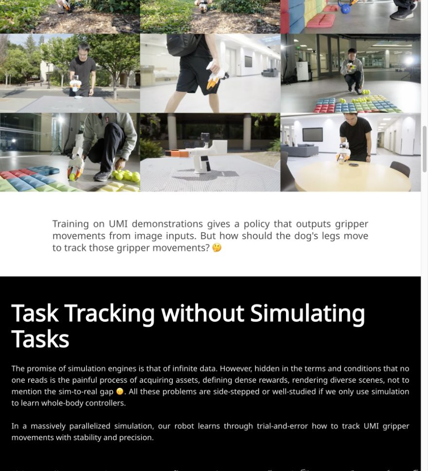
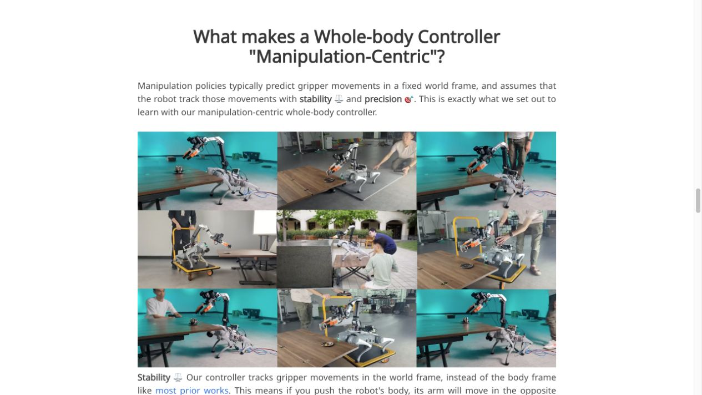
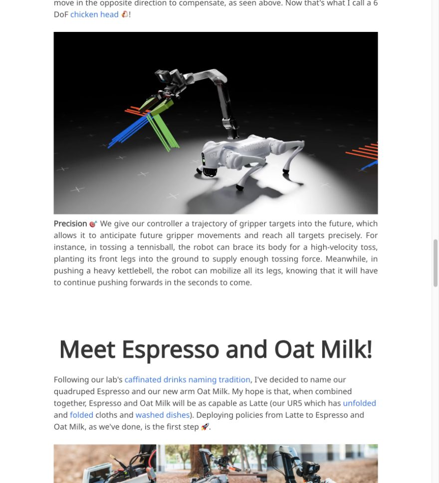
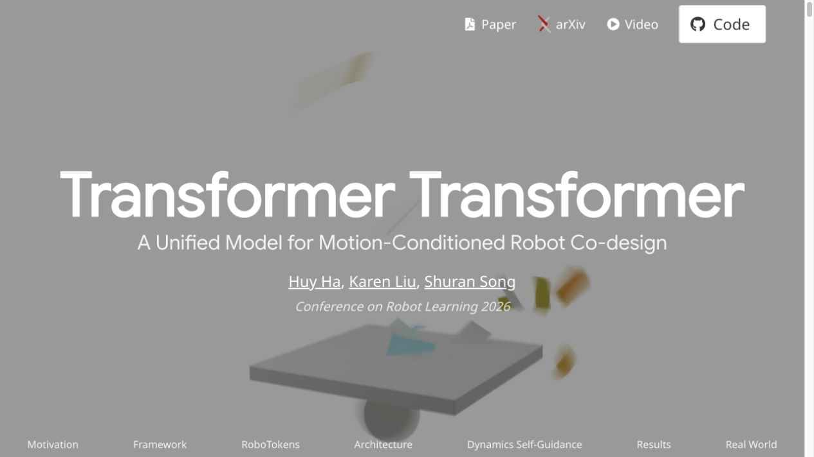
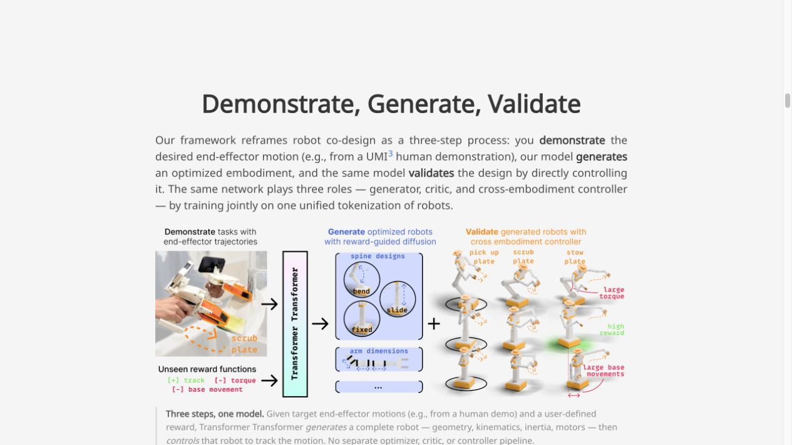
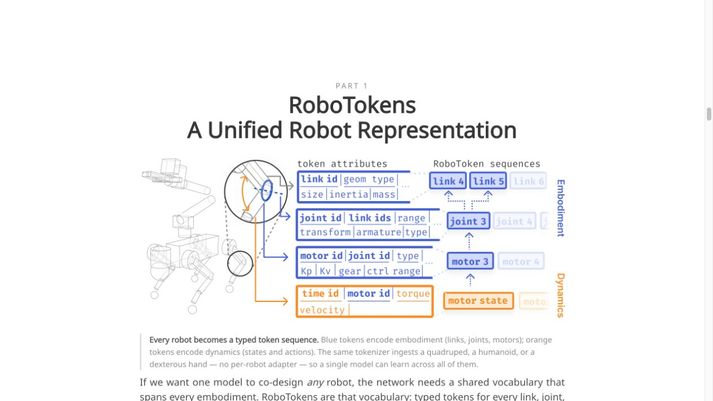
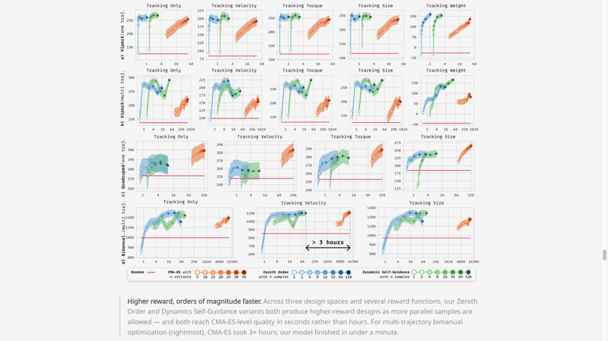

# 项目页的完整案例分析

本章先记录多人合作项目页中可观察到的做法，再给出我们的改编。它们不能证明具体由谁亲自设计了视觉材料。来源链接指向准确的章节；本地截图用于视觉学习，并始终保留为注明来源的参考材料。阅读有关段落时，应同时查看对应截图或视频。

## UMI on Legs：让每个答案带出下一个问题

**观察到的原始结构。** [演示采集](https://umi-on-legs.github.io/#umi)建立便携式数据采集的动机。随后，一段过渡提出：腿部应当如何实现预测的夹爪运动？[仿真跟踪](https://umi-on-legs.github.io/#task-tracking)明确仿真中的具体问题；[控制器解释](https://umi-on-legs.github.io/#wbc)区分稳定性与精确性，并分别搭配演示。[硬件](https://umi-on-legs.github.io/#hardware)让部署方式具体化，[问答](https://umi-on-legs.github.io/#qa)则补充限定条件。[稳定性演示](https://umi-on-legs.github.io/#stable-tracking)展示身体受到扰动时手臂的补偿。[精确性演示](https://umi-on-legs.github.io/#precise-tracking)把未来的夹爪目标与身体的提前响应联系起来。这些视频解释控制器行为，不能替代定量评估。

<figure>
  
  <figcaption>原始页面截图：从演示数据到机器人控制的过渡。来源：<a href="https://umi-on-legs.github.io/#task-tracking">UMI on Legs · Task Tracking</a>；作为注明来源的学习材料保留。<a href="../../image/umi-question-chain.png">查看原尺寸</a>。</figcaption>
</figure>

**执行层面的改编。** 借用布局前，先标注每对章节之间的边界：

| 边界 | 下一段必须合理引出的问题 | 在案例中检查什么 |
|---|---|---|
| `#umi → #task-tracking` | 已经有了期望的夹爪运动；什么让机器人其余部分实现它？ | 采集数据与控制之间的过渡。 |
| `#task-tracking → #wbc` | 为了完成操作，跟踪器必须保持什么？ | 从训练设置转向行为要求的过程。 |
| `#wbc → #hardware` | 哪些信息让控制器能用于真实机器人？ | 行为与部署所需设备之间的联系。 |
| `#hardware → #qa` | 接口与系统假设在哪些地方不再成立？ | 展示出的能力与其边界的区分。 |

**虚构的修改前版本：** “接下来，我们介绍全身控制器。”

**我们的修改后改编：** “我们现在知道夹爪应该做什么。机器人的其余部分应如何运动，才能实现这一目标？”

第二种过渡让控制器回应读者已经理解的需求。用于自己的项目时，应把“夹爪”替换为实际的接口变量。如果接口是一份接触时序，就展示该时序；如果接口是物体位姿轨迹，就展示物体。不要仅因为参考段落读起来顺畅，就照搬它的接口假设。

<figure>
  
  <figcaption>原始页面截图：控制器章节中的稳定性演示及其解释。来源：<a href="https://umi-on-legs.github.io/#wbc">UMI on Legs · Whole-Body Controller</a>。<a href="../../image/umi-wbc.png">查看原尺寸</a>。</figcaption>
</figure>

<figure>
  <video controls preload="metadata" playsinline poster="../../image/umi-stability-poster.jpg">
    <source src="../../image/umi-stability.mp4" type="video/mp4">
  </video>
  <figcaption>稳定性参考视频。来源：<a href="https://umi-on-legs.github.io/#stable-tracking">UMI on Legs · Stable Tracking</a>。也可<a href="../../image/umi-stability.mp4">打开本地视频</a>；下方说明是我们的观察练习。</figcaption>
</figure>

[观看稳定性参考片段](../../image/umi-stability.mp4)。分别在扰动发生前和补偿过程中暂停一次。思考观众能分辨什么：身体位移、手臂响应，以及夹爪与其参考目标之间的关系。为新页面制作标注时，应标明这些可观察的量，而不是增加泛泛的“鲁棒性”徽章。相邻的精确性示例应回答另一个问题；两者若使用相同图注，就会抹掉区别。

<figure>
  
  <figcaption>原始页面截图：相邻的精确性演示回答另一个控制问题。来源：<a href="https://umi-on-legs.github.io/#precise-tracking">UMI on Legs · Precise Tracking</a>。<a href="../../image/umi-precision.png">查看原尺寸</a>。</figcaption>
</figure>

<figure>
  <video controls preload="metadata" playsinline poster="../../image/umi-precision-poster.jpg">
    <source src="../../image/umi-precision.mp4" type="video/mp4">
  </video>
  <figcaption>精确性参考视频。来源：<a href="https://umi-on-legs.github.io/#precise-tracking">UMI on Legs · Precise Tracking</a>。也可<a href="../../image/umi-precision.mp4">打开本地视频</a>；下方说明是与稳定性不同的观察练习。</figcaption>
</figure>

[观看精确性参考片段](../../image/umi-precision.mp4)。比较身体的提前运动与夹爪随后的运动。这与抵抗身体扰动是不同的观察任务；应为它单独撰写图注与解释。

**一个具体的编辑任务。** 取三个相邻章节，标出它们的开头句与结尾句。重写交界处，直到每一节都给下一节提供存在的理由。先隐藏图片，朗读这些句子；再恢复图片，检查每一张是否回答了刚刚提出的问题。

## Transformer Transformer：先建立词汇，再解释机制

**观察到的原始结构。** 首屏把标题与动画放在一起；紧随其后的摘要给出主要的硬件结果指标。[框架](https://transformer-transformer.github.io/#framework)展示三个步骤：示范运动、生成设计、通过控制验证设计。[表示](https://transformer-transformer.github.io/#robotokens)用蓝色表示具身结构，用橙色表示动力学信息。[架构](https://transformer-transformer.github.io/#architecture)先解释条件信息，[自引导](https://transformer-transformer.github.io/#self-guidance)随后解释如何用奖励引导生成。[结果](https://transformer-transformer.github.io/#results)接着引向[硬件证据](https://transformer-transformer.github.io/#real-world)与[局限](https://transformer-transformer.github.io/#limitations)。表示图、图注和正文提供逐层加深的解释，而不是一份没有层次的规格说明。

<figure>
  
  <figcaption>原始页面截图：标题与动画构成入口首屏。来源：<a href="https://transformer-transformer.github.io/">Transformer Transformer · 项目入口</a>。<a href="../../image/tt-hero.png">查看原尺寸</a>。</figcaption>
</figure>

<figure>
  <video controls preload="metadata" playsinline poster="../../image/tt-hero-poster.jpg">
    <source src="../../image/tt-hero.mp4" type="video/mp4">
  </video>
  <figcaption>原始入口动画，用于研究注意力与视觉身份。来源：<a href="https://transformer-transformer.github.io/">Transformer Transformer · 项目入口</a>。也可<a href="../../image/tt-hero.mp4">打开本地视频</a>。</figcaption>
</figure>

[观看入口动画](../../image/tt-hero.mp4)。这是一份研究注意力与视觉身份的有用材料，但不意味着每个项目都该把指标放进全屏首屏。为自己的页面作决策时，应判断动画是在澄清研究问题，还是只是推迟解释。让后续摘要便于访问，并确保摘要的论断能够追溯到页面下方的证据。

<figure>
  
  <figcaption>原始页面截图：三步框架先说明整体任务，再介绍内部机制。来源：<a href="https://transformer-transformer.github.io/#framework">Transformer Transformer · Framework</a>。<a href="../../image/tt-framework.png">查看原尺寸</a>。</figcaption>
</figure>

**框架改编。** 润色复杂的架构图之前，先画三个空框，分别表示输入、转换和验证。填入实际对象，不要只填模块缩写。每个框下写出对应的读者问题：

1. 我需要提供什么？
2. 方法会产出什么？
3. 我们如何判断产出有效？

如果第三个框只是重复一张生成的图像，验证关系仍然缺失。框架应当说明输出如何被评估，即使详细评估放在另一节。

<figure>
  
  <figcaption>原始页面截图：两组 token 为后续解释建立词汇与颜色语义。来源：<a href="https://transformer-transformer.github.io/#robotokens">Transformer Transformer · RoboTokens</a>。<a href="../../image/tt-robotokens.png">查看原尺寸</a>。</figcaption>
</figure>

**颜色改编。** 在自己的项目内保持颜色含义一致。例如，只有图示确实区分机器人描述与变化的状态／动作信息时，才为它们分别安排一种颜色。同时添加文字标签。在架构图、逐步呈现的动画与图注中复用这些含义。同一个概念在不同章节中换色，会迫使读者重新学习词汇。

**虚构的修改前版本：** “我们的网络采用掩码扩散和基于梯度的奖励引导。”

**我们的修改后改编：** “先展示哪些信息已经给定、哪些必须生成，再解释如何把生成的候选方案引向所要求的目标。”

这是一份解释计划，不是用于替换技术正文的文字。最终段落应写明项目真实的条件规则与目标。表示章节必须让名词变得可识别；架构章节必须解释操作；随后，优化章节才有基础解释如何引导该操作。

<figure>
  
  <figcaption>原始页面截图：结果出现在方法解释之后，构成独立的证据层。来源：<a href="https://transformer-transformer.github.io/#results">Transformer Transformer · Results</a>。<a href="../../image/tt-results.png">查看原尺寸</a>。</figcaption>
</figure>

**结果改编。** 为每个连接准备一句话：方法 → 比较、比较 → 真实机器人测试、真实机器人测试 → 边界。一种有用的写法是：“比较检验所提出的操作在这些条件下是否有帮助；硬件测试检验这种收益在部署后是否仍然存在；局限说明哪些假设仍需成立。”将这些泛称替换为真实条件与发现。不要用精选的成功片段代替结果分布。

## 较小的交叉检查：区分共同逻辑与单页风格

**观察：** [Scaling Up](https://huy-ha.github.io/scalingup/)把简短的能力说明与视觉材料放在一起；末尾问答中关于彩色线条的问题说明了策略轨迹的含义。**改编：** 视觉材料有吸引力却令人陌生时，补充一句解释以及更深入说明的链接。读者无法解读的装饰性轨迹，并没有解释方法。

**观察：** [原始 UMI 页面](https://umi-gripper.github.io/)把人类演示与自主执行放在一起，并在后面通过配对条件组织任务示例。**改编：** 让两个画面回应同一个视觉问题。比较人类与机器人时，保持物体和任务阶段可识别；进行消融时，写明改变的条件。与赋予比较一个具体任务相比，沿用配色或圆角视频边框，是更弱的可迁移经验。

迁移因果解释与证据关系；根据实际项目选择动画、配色、语气和章节数量。
